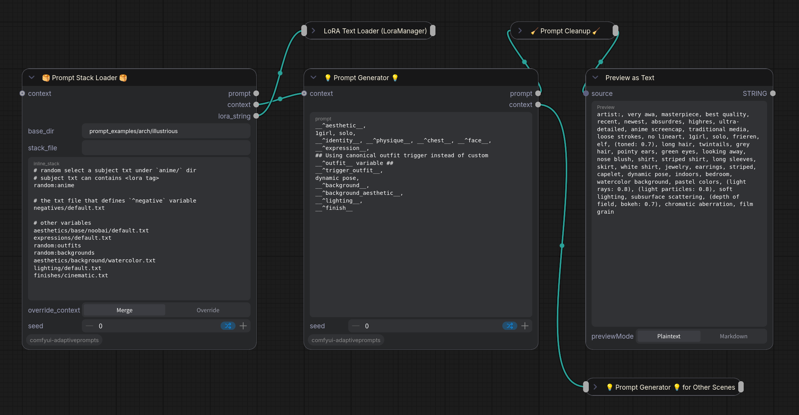

# Adaptive Prompts Extensions

This is a companion extension node for [comfyui-adaptiveprompts](https://github.com/Alectriciti/comfyui-adaptiveprompts) that adds advanced, experimental, or specific workflow-related features to the core engine.

## 📦 Installation
If you are not using ComfyUI Manager (or if the node is not yet available in the Manager's registry), you can install this extension manually:

1. Open your terminal or command prompt.
2. Navigate to your ComfyUI `custom_nodes` directory:
   ```bash
   cd ComfyUI/custom_nodes/
   ```
3. Clone this repository:
   ```bash
   git clone https://github.com/your-username/comfyui-adaptiveprompts-extensions.git
   ```
4. Restart ComfyUI.

### Dependencies
This extension strictly depends on the core **Adaptive Prompts** engine. You **MUST** have the official [comfyui-adaptiveprompts](https://github.com/Alectriciti/comfyui-adaptiveprompts) node installed in your `custom_nodes` folder for this extension to function.

> **Recommended Configuration (Latest `comfyui-adaptiveprompts`):** Newer versions of `comfyui-adaptiveprompts` introduce a **Missing Wildcard Behavior** setting in the ComfyUI Settings menu that defaults to `"Inject Warning"` (which injects `!!!VARIABLE "..." NOT FOUND!!!` into the prompt when an optional variable is unset). If your modular stacks rely on optional variables that are not defined in every run, set **Missing Wildcard Behavior** to **`Silently Fail`** in the ComfyUI Settings menu.

---

## 🧩 Nodes Included

### 🥞 Prompt Stack Loader


The **Prompt Stack Loader** is a powerful node designed to sequentially load, parse, and evaluate a stack of text files. Instead of constructing unwieldy monolithic prompt strings, it serves as an orchestrator for **modular prompt configurations** where your logic is distributed across multiple files.

#### Why Use a Stack Loader?
By leveraging this node, you can transition your workflow into a highly adaptable **profile-based system**:
*   **Rapid Context Switching:** Easily switch between different subjects by changing a single line in your stack, automatically pulling in their associated LoRAs and custom styling.
*   **Dynamic Adaptation:** Your main Prompt Generator template dynamically adapts to the current subject, making the process seamless.
*   **Scalability:** The system is designed around a production-ready **Subject Hook Architecture**, allowing you to build complex, highly-detailed prompts cleanly and modularly. 

#### Key Features
*   **Sequential File Processing:** Load and evaluate a list of text files (a "stack") in order. File paths can be relative or specifically pull a random file from a directory.
*   **Modular Stack Composition (`import:`):** Break monolithic stacks into reusable building blocks (headers, footers, subject setups) and import them on demand—eliminating multi-node loader chains and copy-paste drift.
*   **Dynamic Stack Modifiers (`replace:`, `remove:`):** Surgically swap or exclude specific lines in-place across your stack (including lines pulled in via `import:`) without editing the underlying files.
*   **Hidden Files & Local Overrides:** Any file or directory starting with `_` or `.` is completely hidden from the randomizer. This allows you to safely store specialized states or drafts (e.g., `_explicit_override.txt`) alongside your main prompts, loading them only when you explicitly ask for them!
*   **Automatic LoRA Tag Extraction:** Any `<lora:name:weight>` tags found within your stacked files are automatically extracted and compiled into a clean `lora_string` output to be sent directly to a LoRA Tag Loader.
*   **Context Accumulation & Overrides:** As files are processed, variables are collected into a `context` dictionary. You can pass context between multiple Stack Loaders, using the **Override** toggle to cleanly re-roll specific elements (like a character's expression) while keeping the rest of the generation state identical.

For a deeper dive into the **Architecture Philosophy** and ready-to-use template examples, please refer to the **[Real-World Example Stacks Documentation](prompt_examples/README.md)**.

A ready-to-use example workflow is also available: **[Prompt Stack Loader Three Scenes Pipeline](workflow/PromptStackLoaderThreeScenesPipeline.json)**.

#### Node Parameters

- **`base_dir`**: The foundational directory for resolving file paths.
  - **Empty:** Resolves to the `prompts` directory within this extension's folder.
  - **Security Restrictions:** Absolute paths and escaping the base directory via `../` are explicitly disabled. Examples:
    - **Allowed:** `subfolder/file.txt`, `subfolder/../file.txt` (stays inside `base_dir`)
    - **Blocked:** `C:\file.txt`, `/etc/passwd`, `../../outside_file.txt` (escapes `base_dir`)
    Symlinks pointing outside the base directory are blocked, and files exceeding 5MB are skipped.
- **`stack_file`**: The path to a `.txt` file containing your execution stack (e.g., `stacks/illustrious.txt`). *(Note: Unlike the paths inside the stack, this top-level parameter is allowed to use `../` to escape your `base_dir`, as long as it remains inside the extension folder).*
- **`inline_stack`**: A multiline text field used to define paths, import snippets, or apply on-the-fly overrides directly within the node.
- **`override_context`**: Determines how incoming context is handled: **Merge** (appends new variables) or **Override** (replaces existing variables).

> **Note on Paths & Security:** All file paths specified within a `stack_file` or the `inline_stack` must be relative paths. Relative paths are always resolved against your defined `base_dir`. Path resolution is **cross-platform safe** (works across Windows/macOS/Linux) and strictly sandboxed. Symlinks that point outside the `base_dir` are strictly forbidden, and files exceeding 5MB are automatically skipped.

---

#### 📜 Stack Commands Reference

Each line in a `stack_file` or `inline_stack` acts as an instruction. Commands are processed in a two-stage pipeline: **Stage 1** recursively expands all `import:` directives in-place, and **Stage 2** applies `remove:` and `replace:` modifiers before resolving `random:` directories.

##### 1. Composition & Selection Commands

- **`import:<stack_path>`** — Recursively includes another stack file in-place at the exact position of the `import:` line.
  - **Strict `base_dir` Sandbox:** Unlike the node's top-level `stack_file` input, `import:` is strictly constrained to the node's resolved `base_dir`. For example, if `base_dir` is set to `prompt_examples/arch/illustrious`, `import:` can only load files inside `prompt_examples/arch/illustrious` (escaping via `../`, absolute paths, or symlinks pointing outside `base_dir` are blocked, and files >5MB are skipped).
  - **Cycle Protection & Sequential Reuse:** The loader tracks the active import chain (`A -> B -> A`). Circular imports (direct self-imports, mutual cycles, or symlink loops) are automatically skipped with a console warning. However, importing the same snippet twice sequentially in the same stack is allowed and evaluated in order.
- **`random:<folder_path>`** — Selects a deterministic random `.txt` file from the specified directory (including subfolders) using the node's `seed`.
  - Files and directories starting with `_` or `.` are automatically ignored by the randomizer.

##### 2. Stack Modifier Commands

Because `import:` directives are expanded first, `replace:` and `remove:` can target both local lines and lines originating inside any imported stack file:

- **`replace:<old_path>|<new_path>`** — Swaps a matching line in-place while preserving its exact position in the execution order.
  - Works on both standard file paths and `random:` lines (e.g., `replace:lighting/sunny.txt|lighting/rainy.txt` or `replace:random:anime|anime/frieren/frieren.txt`).
- **`remove:<file_path>`** — Excludes a matching line from being loaded (e.g., `remove:styles/cyberpunk.txt`).
  - Because `<lora:...>` tags are always accumulated across the stack and ignore the **Override** toggle, `remove:` is the primary way to exclude a file containing an unwanted LoRA.

##### 3. Comments & Hidden Overrides

- **`# <comment>`** — Lines starting with `#` are ignored (including commented-out commands like `#import:stacks/draft.txt`).
- **Hidden Files (`_file.txt`, `_folder/`)** — Prefixing files or directories with `_` or `.` hides them from `random:<folder_path>` while still allowing you to load them *explicitly* by path (e.g., `anime/evangelion/_asuka_override.txt`).

#### Node Outputs

- **`prompt` (STRING):** The fully evaluated, comma-separated string containing all the text and resolved wildcards from the processed files, with LoRA tags stripped out.
- **`context` (DICT):** The accumulated dictionary of variables created during the evaluation of the stack. This can be passed to a Prompt Generator or another Stack Loader.
- **`lora_string` (STRING):** A clean string containing all `<lora:name:weight>` tags found across all files in the stack, ready to be passed to a LoRA Tag Loader.

---

## 🔀 Advanced Macros: `ps_switch`

The Prompt Stack Loader includes a built-in pre-processor macro for conditional branching across files. This is extremely useful when an action or clothing choice needs to adapt perfectly to a background scene you loaded earlier in the stack.

For example, imagine a global stack that first loads a specific background scene:
`backgrounds/scenes/urban/cafe_interior.txt`
This file sets the background details, and defines a scene variable:
`{cafe}^scene`

Later in the same stack (or in a separate downstream Stack Loader), you load an action file, for example, `actions/leisure/drinking.txt`. Because the scene variable was established upstream, you can use the `ps_switch(var)` macro to contextually adapt the pose:

```text
{
  dynamic pose,
  {ps_switch(scene)
    | cafe: sitting at table, holding a coffee cup
    | swimming pool | beach: splashing water, looking at the horizon
    | default: standing casually
  }
}^action
```

**How it works:**
*   **Contextual Matching:** The `PromptStackLoader` checks its accumulated context for the variable `scene`. If it finds `cafe`, it swaps the entire `ps_switch` block with `sitting at table, holding a coffee cup`.
*   **Shared Results (Fallthrough):** You can share a single result across multiple cases by separating them with pipes (e.g., `| swimming pool | beach: splashing water`).
*   **Default Fallback:** If the variable resolves to something else, or isn't defined at all, it outputs the `default:` branch.
*   **Safe "Pass-Through":** If the variable `scene` is completely missing from the upstream context, the macro safely resolves to the `default:` fallback (or an empty string if no default is provided) to prevent syntax errors.

> **Note:** Because `ps_switch` runs as a stack-level macro *before* core prompt evaluation, it relies entirely on variables defined in *previous* files in the stack. If you assign a variable and attempt to switch on it within the **exact same file**, it will use the old upstream value instead.

---

## 💡 Pro Tips & Advanced Workflows

### 🧱 Modular Stack Composition: Combining `import:` with `replace:` & `remove:`

Instead of chaining multiple `PromptStackLoader` nodes in your ComfyUI graph (e.g., Root Loader → Intermediate Loader → Leaf Loader) or copy-pasting boilerplate headers and footers across dozens of scene stacks, you can compose scenes declaratively using `import:`.

Because `import:` directives are recursively expanded **before** `replace:` and `remove:` are evaluated, you can store common style presets, environment setups, or rendering footers in a shared `stacks/` folder and surgically tweak individual lines per scene.

**Example: Shared Preset Snippet (`stacks/presets/watercolor_daylight.txt`)**
```text
negatives/default.txt
aesthetics/base/noobai/default.txt
aesthetics/background/watercolor.txt
lighting/sunny.txt
finishes/cinematic.txt
finishes/film_grain.txt
```

**Example: Scene Stack (`scenes/rainy_cafe.txt`)**
Suppose this specific scene wants the same base preset, except it takes place in the rain (`lighting/rainy.txt` instead of `lighting/sunny.txt`) and wants a clean render without `finishes/film_grain.txt`:

```text
# 1. Load subject and pull in the shared style preset
anime/frieren/frieren.txt
import:stacks/presets/watercolor_daylight.txt

# 2. Surgically customize the imported preset in-place
replace:lighting/sunny.txt|lighting/rainy.txt
remove:finishes/film_grain.txt

# 3. Add scene-specific outfit, expression, and background
outfits/winter_coat.txt
expressions/melancholic.txt
backgrounds/urban/cafe_window.txt
```

**Why this works so well:**
* **In-Place Ordering Preserved:** `replace:` swaps `lighting/sunny.txt` for `lighting/rainy.txt` at its exact original position inside the imported preset, ensuring downstream files that depend on earlier variables see the updated state in the right order.
* **Zero Copy-Paste Drift:** Shared boilerplate lives in one place (`stacks/presets/`), while individual scene files stay compact and self-contained.
* **Security & Cycle Safety:** Every `import:` path is strictly sandboxed to the node's `base_dir` (it cannot escape `base_dir` via `../` or symlinks) and protected against circular imports (`A -> B -> A`).

### 🔗 Chained Loaders & Global States

The true power of the `PromptStackLoader` shines when chaining multiple nodes together via the `context` ports. This gracefully bypasses `base_dir` path restrictions and allows you to establish global states (like SFW/explicit modes, weather, or time of day) that dynamically control downstream subjects—even when those subjects are selected randomly!

By pairing chained loaders with the `ps_switch` macro, you can encapsulate all character variations directly inside their own files, allowing upstream loaders to dictate their state.

**Example: Global Modifiers with Random Subjects**

```text
[ Node 1: Global State ]
base_dir: prompts/vars
inline_stack: mode_explicit.txt (contains: {explicit}^mode)
         |
    (context out)
         |
[ Node 2: Subject Generator ]
base_dir: prompts/anime
inline_stack: random:characters
```

Because Node 1 passes the `mode` variable downstream, any random character picked by Node 2 (e.g., `characters/frieren.txt`) instantly reacts to the global state:

```text
# frieren.txt

{{ps_switch(mode)
  | explicit: revealing white dress, collarbone
  | default: classic white dress, winter coat
}}^outfit
```

This architecture keeps your prompt files highly modular, ensures `random:` selection remains powerful without breaking, and completely eliminates the need for messy override scripts or folder structures.

### 🔄 Self-Referential Overrides (Infinite Stacking)

A powerful way to keep your master templates clean is to use **self-referential variables** to modify existing states without needing dedicated placeholder variables (like `__^outfit_state__`) in your base template.

Because variables defined later in the stack seamlessly overwrite earlier ones, an override file can recall its own previous value, append a new modifier, and save it back!

**Example: Stacking Outfit Modifiers**
Imagine you have a base template that simply calls `__^outfit__`.
1. Your stack first loads `outfits/school_uniform.txt`, which contains:
   `{white shirt, blue pleated skirt}^outfit`
2. Your stack then loads an override state file like `outfit_states/_wet.txt`. Instead of setting a brand new variable, it references the existing one:
   `{__^outfit__, wet seethrough fabric}^outfit`
3. Finally, your stack loads `outfit_states/_torn.txt`:
   `{__^outfit__, torn edges}^outfit`

**The Result:** The engine elegantly accumulates the values: `white shirt, blue pleated skirt, wet seethrough fabric, torn edges`—all stored perfectly under the single `^outfit` variable. 

This guarantees your main templates stay completely free of bloat, while giving you the flexibility to infinitely stack states (wet, dirty, torn) just by chaining text files!

> **CRITICAL:** For this pattern to work correctly, your `PromptStackLoader` node **must have `override_context` set to `Override`**. If set to `Merge`, the engine will keep both the old and new outfit strings in memory, which may cause the randomizer to sometimes select the old, unmodified outfit.

> **Rule of Thumb:** Order matters. Always load the base definition file before any self-referential override files in your stack.
---

## 🙏 Acknowledgments

A special thank you to **[Alectriciti](https://github.com/Alectriciti/comfyui-adaptiveprompts)** for bringing us so many nice building blocks!
